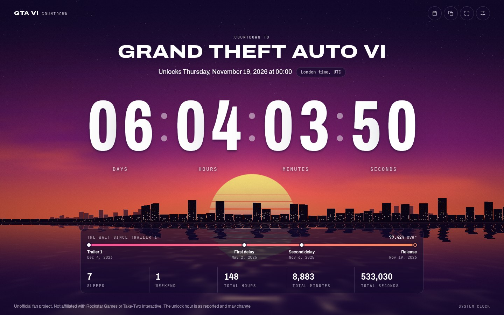
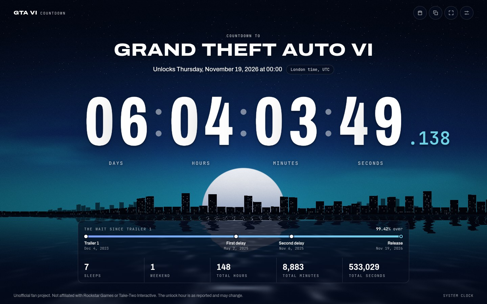
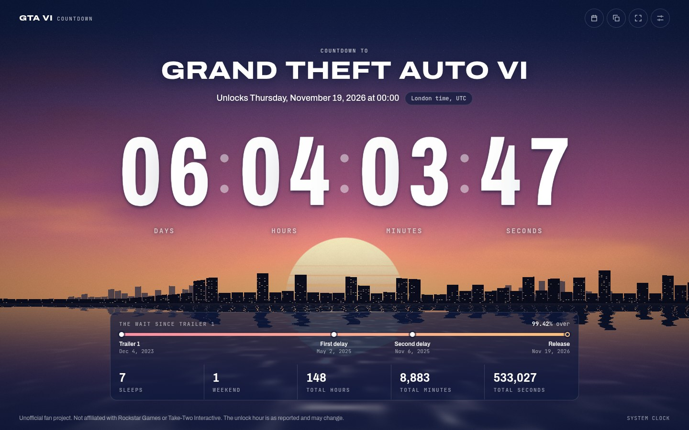

# GTA VI Countdown

A fast, animated countdown to the release of Grand Theft Auto VI on November 19, 2026, and to other upcoming games. The same countdown is built twice, from one design:

- **The web app**, in React and TypeScript, built with Vite. It runs in any modern browser and installs as a home-screen app on phones.
- **The desktop app**, a native Rust application for Linux, Windows and macOS. It draws everything itself with egui and renders the backdrop on the GPU through wgpu, which uses Vulkan, Metal or DirectX 12. There is no web view.



> [!WARNING]
> **Made entirely by AI.** This project was built as a test of the programming capabilities of Claude Fable 5.2, with later changes by Claude Opus 5.5. All of the code and documentation was written by AI, with no hand-written code. It has not been audited, so **use it at your own risk**. It is in the public domain: anyone may copy it and use it however they wish (see [License](#license)).

## Features

Both apps have the same features and wording, unless noted.

- **More than one game.** Grand Theft Auto VI by default, with Metro 2039, God of War Laufey, Fable and Final Fantasy VII Revelation to choose from, or any game you enter yourself with its own date and unlock time.
- **Accurate to the millisecond.** The display is derived from the wall clock on every tick, so it cannot drift, and each tick is scheduled on the exact boundary where the seconds value changes.
- **Time zone aware.** Games unlock at a local time, so the release moment differs by region. The countdown follows the device's time zone by default and can be pointed at any IANA zone.
- **Network time correction.** The desktop app measures the error of the system clock against an NTP server and corrects the countdown, with its own SNTP client.
- **Animated backdrop.** A sunset skyline rendered in a single fragment shader, with four quality settings: Auto lowers the resolution when the frame rate drops, High renders every device pixel with more cloud detail, Low saves power and Off shows a still gradient. It pauses when the window is hidden and falls back to the gradient when the GPU is unavailable.
- **Three themes.** Dusk, Midnight and Dawn.
- **More than one way to count.** Sleeps, weekends and total hours, minutes and seconds remaining, with a timeline of the wait since each game's first milestone.
- **Release alert.** An optional system notification at the moment of release.
- **Calendar export.** Saves the release as an iCalendar event with reminders.
- **Compact mode.** Small windows reduce to the timer alone, which pairs with the desktop app's always-on-top option to make a desktop widget.
- **Accessible.** Keyboard control, screen reader labels and support for the reduced motion preference.
- **After release.** The display switches to the time elapsed since launch.

| Midnight, with milliseconds | Dawn |
| --- | --- |
|  |  |

## The two apps

| | Web app | Desktop app |
| --- | --- | --- |
| Directory | [`web/`](web/) | [`desktop/`](desktop/) |
| Language | TypeScript | Rust |
| User interface | [React 19](https://react.dev) | [egui](https://github.com/emilk/egui) through eframe |
| Graphics | WebGL 1 | [wgpu](https://wgpu.rs): Vulkan, Metal, DirectX 12 or OpenGL ES |
| Build and tests | [Vite 8](https://vite.dev), [Bun](https://bun.sh) | Cargo |
| Platforms | browsers, phones | Linux, Windows, macOS |
| Network time, always on top | no | yes |

Both store settings as the same JSON object: the web app in the browser's local storage, the desktop app in a file. [DOCUMENTATION.md](DOCUMENTATION.md) explains how they are built.

## The web app (React)

### Requirements

[Bun](https://bun.com/docs/installation) 1.4 or later. Install it with `curl -fsSL https://bun.com/install | bash`, or see the [installation guide](https://bun.com/docs/installation) for other methods.

### Getting started

```sh
cd web
bun install
bun run dev
```

The development server listens on <http://localhost:1420>.

To produce and preview a production build:

```sh
bun run build
bun run preview
```

The output in `dist/` is a static site. It uses relative asset URLs and can be served from any path on any static host.

### Scripts

| Command | Purpose |
| --- | --- |
| `bun run dev` | Start the Vite development server. |
| `bun run build` | Type-check, then build the site into `dist/`. |
| `bun run preview` | Serve the production build locally. |
| `bun run check` | Type-check the TypeScript and TSX sources. |
| `bun test` | Run the unit tests. |
| `bun run deploy` | Build and upload to Cloudflare Pages. |

### Deploying to Cloudflare Pages

**From the command line.** Log in once, then build and upload in one step:

```sh
bunx wrangler login
bun run deploy
```

The first deploy creates a Pages project named `gtavi-countdown` (set in `wrangler.toml`; change it if the name is taken). `bun run pages:dev` serves the build locally through Wrangler, with the same headers as production.

**From Git.** In the Cloudflare dashboard, create a Pages project connected to the repository and use:

| Setting | Value |
| --- | --- |
| Framework preset | None |
| Root directory | `web` |
| Build command | `bun run build` |
| Build output directory | `dist` |
| Environment variable | `BUN_VERSION` = `1.4.4` |

`web/public/_headers` is copied into the build and sets the content security policy, long-lived caching for the hashed files in `assets/`, and a few security headers.

The site also works as an installable web app: it ships a web manifest and home-screen icons for iOS and Android.

## The desktop app (Rust)

### Requirements

- Rust 1.95 or later. [rustup](https://rustup.rs) installs the latest stable toolchain on any platform. No system development libraries are needed to build the app.
- A GPU driver with Vulkan (Linux, Windows), Metal (macOS) or DirectX 12 (Windows). Where none is available, wgpu falls back to OpenGL ES 3.0, and failing that the backdrop shows a still gradient.
- At run time on Linux: libxkbcommon and, for notifications, a running notification service; desktop distributions install both by default. An X11 session also needs the X11 keyboard library: `libxkbcommon-x11-0` on Debian and Ubuntu, `libxkbcommon-x11` on Fedora and Arch. Vulkan drivers come with Mesa (`mesa-vulkan-drivers` on Debian and Ubuntu, `mesa-vulkan-drivers` on Fedora, `vulkan-radeon`, `vulkan-intel` or `nvidia-utils` on Arch).

### Commands

Run these from `desktop/`.

```sh
cargo test --workspace                 # run the tests
cargo run --release                    # build and run the app
cargo build --release                  # binary in target/release/gtavi-countdown
cargo install --path crates/app        # install to ~/.cargo/bin
```

The executable is self-contained: the fonts and shaders are compiled into it. A desktop entry and icon for packaging are in `desktop/assets/`. `WGPU_BACKEND=vulkan`, `metal`, `dx12` or `gl` forces a graphics backend; the settings panel shows which one is in use.

## Settings and files

The web app keeps its settings in the browser's local storage. The desktop app stores them as follows:

| Platform | Settings | Window |
| --- | --- | --- |
| Linux | `~/.config/gtavi-countdown/settings.json` | size, position and maximised state, in `window-state.json` in the same folder |
| Windows | `%APPDATA%\gtavi-countdown\settings.json` | likewise |
| macOS | `~/Library/Application Support/gtavi-countdown/settings.json` | likewise |

Calendar files are downloaded by the web app and saved to the download folder by the desktop app, falling back to the documents folder and then the home folder.

## Keyboard shortcuts

| Key | Action |
| --- | --- |
| `S` | Open or close settings |
| `F` | Toggle fullscreen |
| `M` | Toggle the milliseconds readout |
| `T` | Switch to the next theme |
| `C` | Copy the countdown to the clipboard |
| `Esc` | Close settings |

## Project layout

```text
.
├── web/                        Web app (React)
│   ├── index.html              Page shell
│   ├── src/
│   │   ├── main.tsx            Entry point
│   │   ├── App.tsx             Root component: layout, actions, shortcuts
│   │   ├── app.css             Fonts, design tokens and global styles
│   │   ├── components/         Components, each with a CSS module
│   │   └── lib/
│   │       ├── gl/             WebGL renderer and shader source
│   │       ├── time/           Games, time zone maths, countdown maths, clock
│   │       ├── ics.ts          iCalendar writer
│   │       ├── platform.ts     Browser capabilities
│   │       ├── settings.ts     Settings schema and validation
│   │       └── themes.ts       Colour palettes
│   ├── tests/                  Unit tests for the TypeScript modules
│   └── public/                 Icons, web manifest, Cloudflare headers
├── desktop/                    Desktop app (Cargo workspace)
│   ├── crates/core/            Games, time zones, countdown maths (no UI)
│   ├── crates/timesync/        SNTP client
│   ├── crates/app/             egui application
│   └── assets/                 WGSL shaders, fonts, icon, desktop entry
└── docs/                       Screenshots
```

## Documentation

[DOCUMENTATION.md](DOCUMENTATION.md) covers the architecture of both apps, the games and release moments, timekeeping, rendering, settings, testing, troubleshooting and known limitations.

## The release dates

The built-in dates are the ones the publishers announced. The unlock hour used for each, midnight local time in each region, is as reported and may change. Both apps define the list in one place: [web/src/lib/time/games.ts](web/src/lib/time/games.ts) and [desktop/crates/core/src/games.rs](desktop/crates/core/src/games.rs).

## Disclaimer

This is an unofficial fan project. It is not affiliated with, endorsed by or sponsored by the developers or publishers of any game it shows, including Rockstar Games, Take-Two Interactive Software, 4A Games, Deep Silver, Santa Monica Studio, Sony Interactive Entertainment, Playground Games, Microsoft and Square Enix. Game titles are trademarks of their respective owners and are used here only to identify the games. The project contains no assets from any game; the artwork is generated procedurally.

Grand Theft Auto, Grand Theft Auto VI, GTA and all related names, marks and content are © Rockstar Games, Inc. and Take-Two Interactive Software, Inc. All rights reserved. This project will be taken down or changed on request of the copyright or trademark holders.

## License

Released into the public domain under [The Unlicense](LICENSE.md). Copy it, change it, ship it, sell it or reuse any part of it however you like, with or without credit.

The software is provided as is, without warranty of any kind. See [LICENSE.md](LICENSE.md) for the full text.

The bundled typefaces, Archivo and JetBrains Mono, are not covered by the Unlicense; they are distributed under the SIL Open Font License 1.1.
