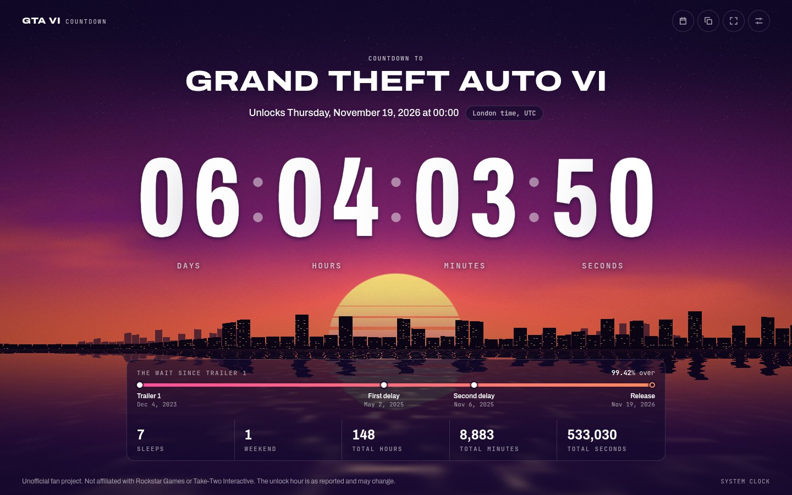
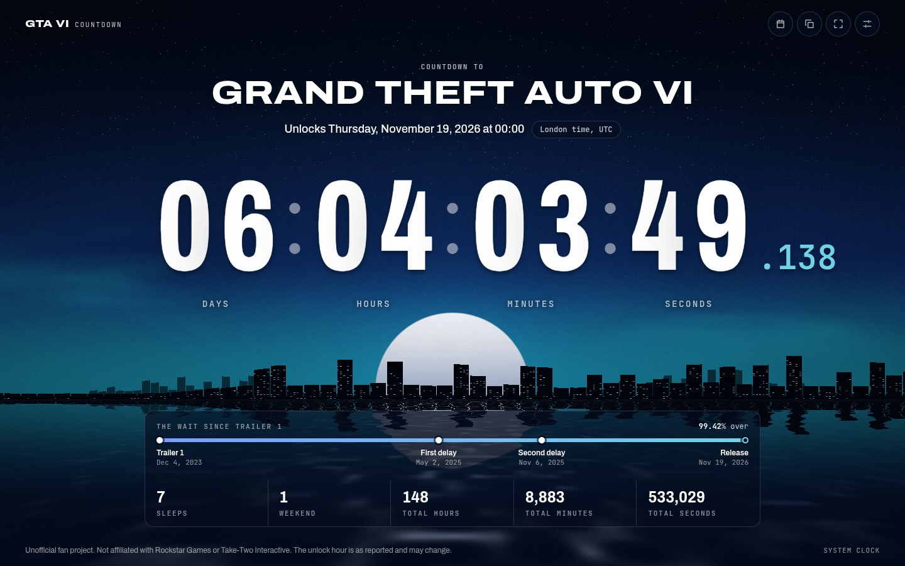
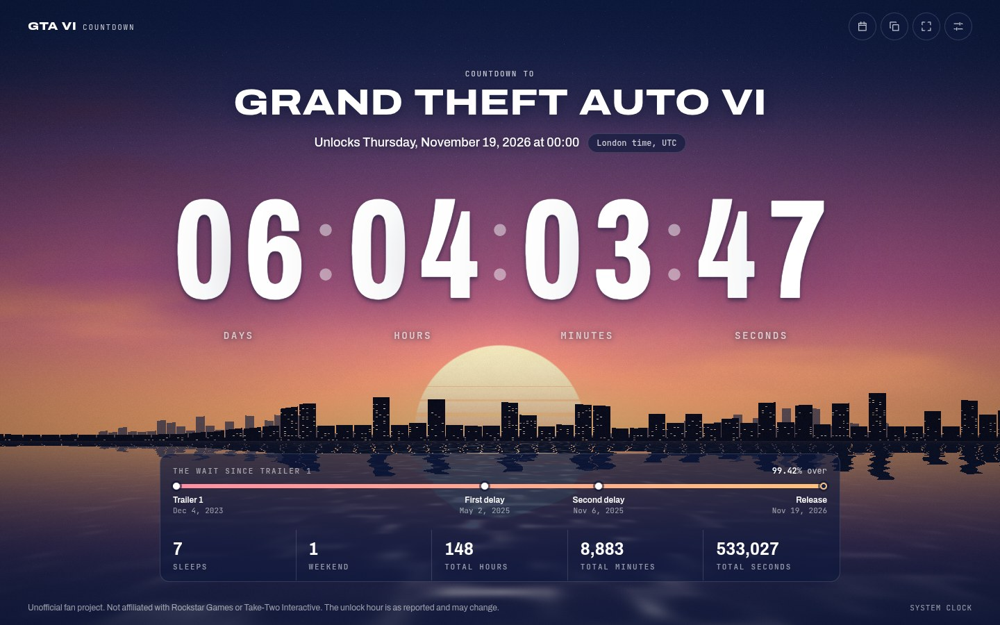

# GTA VI Countdown

A fast, animated countdown to the release of Grand Theft Auto VI on November 19, 2026. It runs in any modern browser and ships as a native desktop application built with Tauri.



> [!WARNING]
> **Made entirely by AI.** This project was built as a test of the programming capabilities of Claude Fable 5.2, with later changes by Claude Opus 5.5. All of the code and documentation was written by AI, with no hand-written code. It has not been audited, so **use it at your own risk**. It is in the public domain: anyone may copy it and use it however they wish (see [License](#license)).

## Features

- **Accurate to the millisecond.** The display is derived from the wall clock on every tick, so it cannot drift, and each tick is scheduled on the exact boundary where the seconds value changes.
- **Time zone aware.** The game unlocks at midnight local time, so the release moment differs by region. The countdown follows the device's time zone by default and can be pointed at any IANA zone.
- **Network time correction.** The desktop application measures the error of the system clock against an NTP server and corrects the countdown, using an SNTP client written in Rust with no dependencies.
- **Animated backdrop.** A sunset skyline rendered in a single WebGL fragment shader. It lowers its own resolution when the frame rate drops, pauses when the window is hidden and falls back to a static gradient when WebGL is unavailable.
- **Three themes.** Dusk, Midnight and Dawn.
- **More than one way to count.** Sleeps, weekends and total hours, minutes and seconds remaining, with a timeline of the wait since the first trailer.
- **Release alert.** An optional system notification at the moment of release.
- **Calendar export.** Saves the release as an iCalendar event with reminders.
- **Compact mode.** Small windows reduce to the timer alone, which pairs with the always-on-top option to make a desktop widget.
- **Accessible.** Full keyboard control, screen reader labels and support for the reduced motion preference.
- **After release.** The display switches to the time elapsed since launch.

| Midnight, with milliseconds | Dawn |
| --- | --- |
|  |  |

## Technology

| Layer | Choice |
| --- | --- |
| Runtime and package manager | [Bun](https://bun.sh) |
| User interface | [Svelte 5](https://svelte.dev) with TypeScript |
| Build tool | [Vite 8](https://vite.dev) |
| Graphics | WebGL 1, hand-written GLSL |
| Desktop shell | [Tauri 2](https://tauri.app) (Rust) |
| Tests | `bun test` and `cargo test` |

## Requirements

- Bun 1.4 or later.
- For the desktop application only: a Rust toolchain (1.77.2 or later) and the Tauri system dependencies for your platform, listed under [Desktop application](#desktop-application).

## Getting started

```sh
bun install
bun run dev
```

The development server listens on <http://localhost:1420>.

To produce and preview a production build:

```sh
bun run build
bun run preview
```

The output in `dist/` is a static site. It uses relative asset URLs and can be served from any path on any static host.

## Deploying to Cloudflare Pages

**From the command line.** Log in once, then build and upload in one step:

```sh
bunx wrangler login
bun run deploy
```

The first deploy creates a Pages project named `gtavi-countdown` (set in `wrangler.toml`; change it if the name is taken). `bun run pages:dev` serves the build locally through Wrangler, with the same headers as production.

**From Git.** In the Cloudflare dashboard, create a Pages project connected to the repository and use:

| Setting | Value |
| --- | --- |
| Framework preset | None |
| Build command | `bun run build` |
| Build output directory | `dist` |
| Environment variable | `BUN_VERSION` = `1.4.4` |

`public/_headers` is copied into the build and sets the content security policy, long-lived caching for the hashed files in `assets/`, and a few security headers.

The site also works as an installable web app: it ships a web manifest and home-screen icons for iOS and Android.

## Desktop application

### System dependencies

**Debian and Ubuntu, including WSL 2**

```sh
sudo apt update
sudo apt install build-essential pkgconf curl wget file \
  libwebkit2gtk-4.1-dev libxdo-dev libssl-dev \
  libayatana-appindicator3-dev librsvg2-dev
```

**Windows**

Install the Microsoft C++ Build Tools. The WebView2 runtime is part of Windows 10 (version 1803 and later) and Windows 11.

**macOS**

Install the Xcode Command Line Tools with `xcode-select --install`.

Rust is installed with [rustup](https://rustup.rs) on every platform. The Tauri documentation keeps the authoritative list of [prerequisites](https://tauri.app/start/prerequisites/).

### Running and building

```sh
bun run desktop:dev      # development window with hot reload
bun run desktop:build    # optimised binary and installers
```

Build artefacts are written to `src-tauri/target/release/`, with installers under `bundle/`. To build a single package format, pass it to the Tauri CLI, for example `bun tauri build --bundles deb`.

## Scripts

| Command | Purpose |
| --- | --- |
| `bun run dev` | Start the Vite development server. |
| `bun run build` | Build the web application into `dist/`. |
| `bun run preview` | Serve the production build locally. |
| `bun run check` | Type-check TypeScript and Svelte sources. |
| `bun test` | Run the unit tests. |
| `bun run desktop:dev` | Run the desktop application in development. |
| `bun run desktop:build` | Build the desktop application for release. |

The Rust tests are run from the `src-tauri` directory with `cargo test --workspace`.

## Keyboard shortcuts

| Key | Action |
| --- | --- |
| `S` | Open or close settings |
| `F` | Toggle fullscreen |
| `M` | Toggle the milliseconds readout |
| `T` | Switch to the next theme |
| `C` | Copy the countdown to the clipboard |
| `Esc` | Close settings |

## Project layout

```text
.
├── index.html              Application shell
├── src/
│   ├── App.svelte          Root component: layout, actions, shortcuts
│   ├── app.css             Fonts, design tokens and global styles
│   └── lib/
│       ├── components/     User interface components
│       ├── gl/             WebGL renderer and shader source
│       ├── time/           Release data, time zone maths and the clock
│       ├── ics.ts          iCalendar writer
│       ├── platform.ts     Bridge between the web app and the desktop shell
│       ├── settings.ts     Settings schema and validation
│       └── themes.ts       Colour palettes
├── tests/                  Unit tests for the TypeScript modules
├── src-tauri/              Desktop shell (Rust)
│   ├── src/                Application entry point and commands
│   ├── crates/timesync/    SNTP client
│   ├── capabilities/       Permissions granted to the window
│   └── tauri.conf.json     Window, security and bundling configuration
└── docs/                   Screenshots
```

## Documentation

[DOCUMENTATION.md](DOCUMENTATION.md) covers the architecture, the timekeeping model, the rendering pipeline, the desktop shell, configuration, testing and troubleshooting.

## The release time

Rockstar Games has announced the date. The unlock hour used here, midnight local time in each region, is the timing reported at the time of writing and may change. The date and hour are defined in one place, [src/lib/time/release.ts](src/lib/time/release.ts).

## Disclaimer

This is an unofficial fan project. It is not affiliated with, endorsed by or sponsored by Rockstar Games or Take-Two Interactive Software. Grand Theft Auto and the names of its publishers are trademarks of their respective owners and are used here only to identify the game. The project contains no assets from the game; the artwork is generated procedurally.

## License

Released into the public domain under [The Unlicense](LICENSE.md). Copy it, change it, ship it, sell it or reuse any part of it however you like, with or without credit.

The software is provided as is, without warranty of any kind. See [LICENSE.md](LICENSE.md) for the full text.

The bundled typefaces, Archivo and JetBrains Mono, are not covered by the Unlicense; they are distributed under the SIL Open Font License 1.1.
